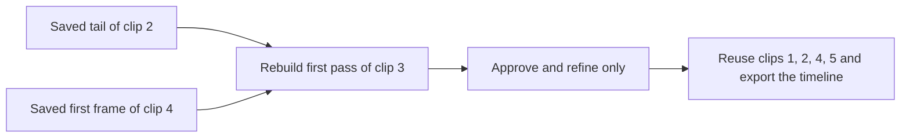

# CineStack H3 / 影栈

**Keep the clips you like. Rework the ones that need it.**

A **multi-segment H3 generation and refinement workbench for ComfyUI**, built for AI video creators, workflow builders and small production teams. Fix seeds per segment, approve first passes before refinement, use neighbouring clips to constrain junctions, and deliver the complete timeline through rolling generation and file-backed video outputs.

**Per-segment control · Inspectable caches · Selective rework · Complete exports**

[中文](README.md) · [Production walkthroughs](docs/production-cases.md#english) · [Example workflows](example_workflows/README.md) · [Install](#install-and-update) · [Changelog](CHANGELOG.md)

Current H3 version: **0.6.10**, installed through Git. Not yet published to Comfy Registry. This repository provides the H3 module; a complete local filmmaking platform is a future direction.

## Keep revisions focused on the clips that need them

| Production problem | What CineStack provides |
| --- | --- |
| One clip needs another attempt | Fix its first-pass seed and run only checked segments; blank seeds still inherit the global value |
| An approved first pass should survive refinement | **Second pass only** uses matching first-pass caches; missing, mismatched or damaged caches stop with reasons |
| A replacement needs to connect to adjacent footage | With continuity enabled, links control constraints from the previous tail and an unselected next clip’s first frame |
| A local revision still needs a complete deliverable | **All export + Rolling** reuses saved unchecked clips and composes the full timeline |
| Longer sequences accumulate decoded frames | Rolling generation and file-backed delivery reduce accumulated pixel storage by retaining current and necessary neighbouring data |

Fixed seeds help manage attempts; they do not guarantee pixel-identical results across models, software versions or devices. Cache reuse also depends on matching inputs, model and sampling settings.

## Production scenario: five clips, rework only clip 3

This walkthrough comes from the project’s revision needs. It is not a timing or visual-quality benchmark.

1. Keep completed clips 1, 2, 4 and 5. Select only clip 3 and change its first-pass seed.
2. Enable continuity. A connected 2–3 edge supplies clip 2’s tail; a connected 3–4 edge supplies clip 4’s first frame when clip 4 is unselected. Disconnect either edge to remove that constraint.
3. Run **First pass only** and review it. Once approved, keep first-pass settings unchanged and choose **Second pass only** for clip 3.
4. Use **All export + Rolling** to combine the new result with saved final videos for the other clips. Choose **Segments + Rolling** when you only want the selected clips.



Only required neighbour boundaries are read for conditioning. Unselected clips are not automatically resampled. Required caches and files must exist; missing data is reported. The right constraint is a visual still, not reverse audio or future-motion generation. Review both picture and sound at the joins.

[Read the steps, cache prerequisites and checks →](docs/production-cases.md#english)

## From first-pass approval to delivery

- **Segment workbench:** inspect thumbnails, planned frames, effective seeds and cache state. Visible First pass only, Second pass only and Follow graph buttons select the execution stage.
- **Preflight:** check execution intent, caches and file-port connections before queuing, with affected segments and recovery actions. Recovery does not automatically start regeneration.
- **Separate results:** preview, download or save first-pass and final videos independently so the source remains available for comparison.
- **H3 entry points:** t2v / i2v / fl2v / r2v / v2v / rv2v, external groups and Director packs. Inherited Refine, SelfLift, Semantic Bridge and FaceRefine features require their respective models and dependencies.

Second pass only requires an enabled, connected Refine configuration (`refine` or `upscale`) and second-pass SIGMAS. `latent_upscale` only enlarges latents; FL2V refinement requires `skip_fl2v=false`. UI cache badges are preliminary checks; execution performs full validation.

## Technical foundation: rolling generation and file delivery

For longer sequences, use **Rolling + file VIDEO outputs**. Generation keeps the current segment and necessary continuity data; FFmpeg composes saved ranges without reconstructing the entire timeline as a Python IMAGE tensor.

| Mode | Delivery scope |
| --- | --- |
| All + Rolling | Generate selected clips, reuse saved unchecked videos, deliver the full timeline |
| Segments + Rolling | Deliver only this run’s selected clips |
| Normal mode | Keep legacy IMAGE/AUDIO wiring; complete IMAGE output still needs full-film memory |

```text
Director first_pass_video ──→ SaveVideo (first pass)
Director final_video      ──→ SaveVideo (final / refined original)
                          └─→ optional postprocessing
```

Connect file outputs directly to official SaveVideo with format/codec `auto`, without CreateVideo or IMAGE-based Video Combine. Normal-mode file connections prompt you to enable rolling. A final stage that has not been generated is unavailable during first-pass-only runs.

Rolling reduces pixel accumulation; it does not guarantee constant total RAM or eliminate OOM. Model residency, segment size, VAE and downstream nodes still affect peaks. File composition incurs disk, encoding and storage costs. Stage diagnostics help locate problems; target-device testing remains necessary.

[Rolling internals](docs/rolling-generation.txt) · [Full export](docs/rolling-full-export.txt) · [Video delivery](docs/rolling-video-delivery.txt) · [Memory diagnostics](docs/memory-diagnostics.txt)

## Keep the approved original; adjust postprocessing separately

Load an already saved second-pass original with LoadVideo to try SR, NR or interpolation without running Director sampling again. Save the original and individual stages so you can locate where quality changes.

The optional [DLSS companion plugin](https://github.com/guomenghao/ComfyUI-DLSS-NeuralRender-Linux) **0.2.1** adds cadence/audio fixes and a video timing guard. Install or update it separately; updating CineStack does not update DLSS. Its streaming path requires VIDEO-only output use; consuming IMAGE outputs can still retain a whole film.

A CPU file-processing regression using an existing 744-frame, 24 fps, 31-second original preserved frame count, cadence and audio duration across two passes. That does not validate GPU SR/NR quality or eliminate interpolation ghosting. Decide which processing stages to use by reviewing your footage.

[Stage wiring and separate saves →](docs/dlss-timing-0.2.1.txt)

## Install and update

Use ComfyUI with official MiniMax H3 support, the matching models and dependencies. Run these commands in **the Python environment used by ComfyUI**, adjusting paths to your installation:

```bash
cd ComfyUI/custom_nodes
git clone https://github.com/guomenghao/ComfyUI-CineStack-H3.git
python -m pip install -r ComfyUI-CineStack-H3/requirements.txt
```

For an existing Git installation:

```bash
cd ComfyUI/custom_nodes/ComfyUI-CineStack-H3
git pull --ff-only
python -m pip install -r requirements.txt
```

Restart ComfyUI and reload the page after updating. Nodes appear under `CineStack/H3`. Before cloning over a manually copied folder, back it up outside `custom_nodes`; preserve unique caches and runtime files. Model weights, user assets and ComfyUI itself are not included.

[Official H3 guide](https://docs.comfy.org/tutorials/video/minimax/minimax-h3) · [Models and examples](example_workflows/README.md)

## Choose a starting point

| Goal | Start here |
| --- | --- |
| Learn basic generation and wiring | [Text-to-video example](example_workflows/minimax_h3_director_t2v.json) |
| Work with character or asset references | [Reference-generation example](example_workflows/minimax_h3_director_r2v.json) |
| Wire first-pass and refined outputs | [Refinement example](example_workflows/minimax_h3_director_二采_加速.json) |
| Rework a clip and export the full timeline | [Production walkthrough](docs/production-cases.md#english) |
| Postprocess an existing refined original | [File-video processing guide](docs/dlss-timing-0.2.1.txt) |

Bundled JSON files are base wiring templates, not preconfigured rolling/strict-refine workflows. Set your models, assets, execution mode and outputs before running. Some linked technical guides are currently in Chinese.

## Compatibility, evidence and limits

- **Existing workflows:** positional widgets and the first eight output indices remain; file VIDEO outputs are appended. Missing new fields keep legacy behavior. Standard old workflows can migrate when only CineStack is installed; coexistence with upstream or API prompts requires the [explicit migration procedure](docs/migration.md).
- **Existing caches:** retain `output/minimax_seg_cache/`, cache names, node IDs and matching parameters, plus referenced source videos. Changed first-pass conditions or links can invalidate reuse. Strict refinement never silently reruns the first pass. Use separate cache names when running both plugins.
- **Junctions:** strict refinement reuses the segment’s saved first-pass constraints. Old caches do not acquire right-hand constraints retroactively. See [junction rules](docs/bidirectional-junctions.txt).
- **Validation:** CPU control-flow/cache tests, real codec regressions and browser tests with a simulated ComfyUI host are provided. Individual server investigations are not performance guarantees for every model, machine or long-film configuration. See [automated checks](https://github.com/guomenghao/ComfyUI-CineStack-H3/actions) and the [changelog](CHANGELOG.md).

## Toward a local filmmaking workbench

The current focus is segment generation, approval, refinement and delivery. Candidate next steps include project/asset version management, task dependencies and recovery, multiple model backends, editing/audio organization and a standalone desktop workbench. These are plans, not implemented full-platform features.

[Roadmap](docs/roadmap.md) · [Issues and suggestions](https://github.com/guomenghao/ComfyUI-CineStack-H3/issues)

For bug reports, include the version, execution mode, export scope, relevant logs and a minimal workflow with private data removed. Do not upload credentials or assets you cannot publish.

## Origins and maintenance

Maintained by **guomenghao**, based on **MiniMax H3 Director by AIMixer and contributors**. CineStack extends per-segment seed control, strict cached refinement, selective rework, rolling delivery and their checks/diagnostics. Upstream features and third-party plugins retain their attribution.

[Apache-2.0](LICENSE) · [NOTICE](NOTICE) · [Upstream documentation](docs/upstream/README_EN.md) · [Full changelog](CHANGELOG.md)

An independent derivative, not an official MiniMax, AIMixer or ComfyUI product.
