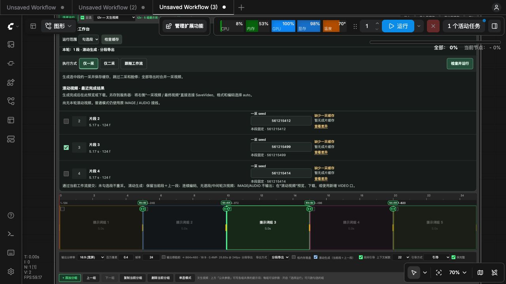
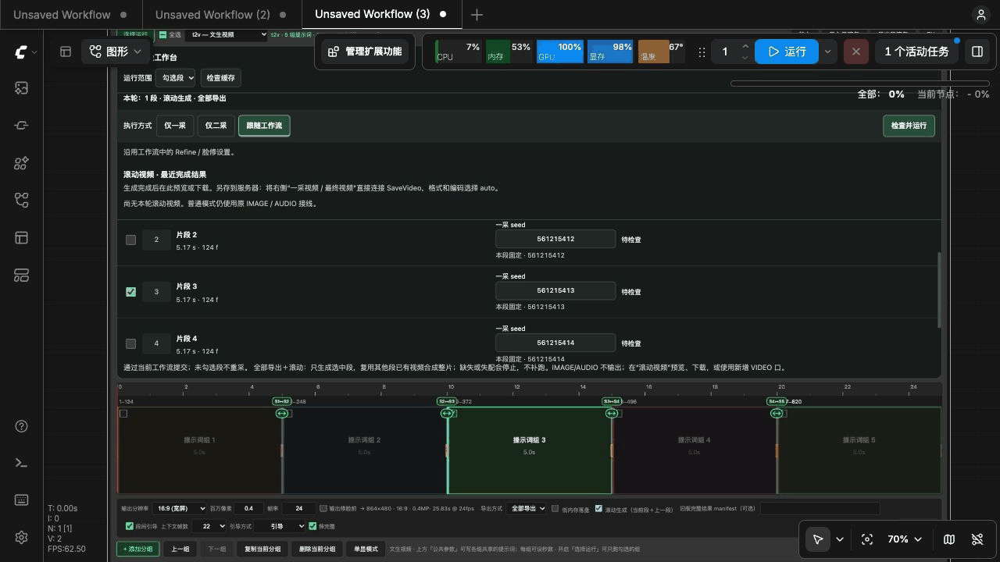

# 新版导演台：五段只重做第 3 段 / Real Director UI walkthrough

[中文首页](../README.md) · [English homepage](../README_EN.md) · [完整制作步骤](production-cases.md)

## 这次演示展示什么

**真实界面，设置演示，未执行生成。** 2026-10-17 在真实 ComfyUI 服务中新建独立的五段空白工作流，通过页面控件设置分段 seed、选择范围、一采/二采和滚动导出；没有点击“检查并运行”或顶部“运行”。拍摄完成后关闭临时工作流并恢复原节点渲染设置，没有修改原工作流、已有视频或缓存，也没有中断服务器原有任务。

演示图没有接入模型、Refine/SIGMAS 或生成缓存，因此截图中的“缺少一采缓存”“请连接并启用影栈 Refine”及禁用运行按钮都是真实状态。它展示**如何配置局部返工**，不表示已经完成第 3 段生成、邻段复用或整片导出。实际执行需要先具备[案例中的接线和缓存前提](production-cases.md)。

## 新版工作台截图

总览中第 2、4 段未勾选，第 3 段已勾选；下方时间轴保留五段。总览列表可滚动，因此截图不同时展开所有五行。截图顶部的系统负载和活动任务来自服务器原有任务，不是本演示的性能测试。

## 五步操作演示

下面是**真实截图组成的逐步动画**，不是连续录屏；每步停留 3–5 秒，循环播放。原始 PNG 保留完整浏览器内容，未替换、绘制或伪造控件/缓存状态。

| 步骤 | 看哪里 | 实际操作与含义 |
| --- | --- | --- |
| [1. 只选第 3 段](media/director-0.6.10/01-select-third.png) | 运行范围、五段时间轴勾选框 | 设置“勾选段”，仅第 3 段选中，其他四段未选 |
| [2. 独立 seed](media/director-0.6.10/02-independent-seed.png) | 第 3 段“一采 seed” | 从 `561215413` 改为 `561215499`；第 1、2、4、5 段保持各自固定值 |
| [3. 仅一采](media/director-0.6.10/03-first-pass.png) | 高亮的仅一采按钮、导出方式 | 选择仅一采、分段导出与滚动生成；这里只设置，没有运行 |
| [4. 仅二采](media/director-0.6.10/04-refine-only.png) | 高亮的仅二采按钮、黄色提示 | 示意一采满意后的阶段切换。演示没有生成一采，也没有接 Refine，预检查如实阻断；不把切换按钮当作已完成一采 |
| [5. 滚动整片导出](media/director-0.6.10/05-rolling-export.png) | 下方“全部导出”“滚动生成”、连接线 | 仅第 3 段仍选中，开启段间引导。实际运行需其他段已有视频可复用；缺失或失配时停止，不自动补跑 |

实际制作中，步骤 3 应先运行、看片并确认一采，再进入步骤 4；本演示按“不重新生成视频”的要求跳过执行和看片环节，没有伪造成功结果。仅二采保留已确认的一采 seed 和其他匹配条件。参见[五段返工完整步骤](production-cases.md)。

## 拍摄与核验

- 影栈 0.6.10，ComfyUI 0.40.0，前端包 1.53.6；使用标准节点渲染拍摄。该前端包低于服务建议版本 1.55.17，本次未升级服务，不能把截图当作所有前端版本的兼容验收。
- 临时关闭 Nodes 2.0 以显示新建节点的自定义面板，拍摄后恢复；此显示问题没有在本次修改代码修复。
- 最终 DOM 控件核验：5 段 seed 各自固定，只有第 3 段选中，滚动生成开启、全部导出、仅二采的运行入口被预检查禁用。
- [拍摄记录及 PNG 校验值](media/director-0.6.10/capture-record.json)。不含用户视频、人物参考图、私人提示词或服务器访问凭据。

## English

**Real interface; settings walkthrough only. No generation was submitted.** These screenshots were captured on a live ComfyUI instance using a separate blank five-segment workflow. The original workflow, cached footage and existing running job were not changed. The temporary workflow was closed afterwards and the original node-rendering setting restored.

No models, Refine/SIGMAS or generated caches were attached. Missing-cache notices and the disabled second-pass run button are genuine. The animation demonstrates configuration, not successful regeneration, cache reuse or a completed export. The server load/activity indicators belong to an existing unrelated task, not a performance benchmark for this demo.

The GIF is a sequence of five real screenshots (3–5 seconds each), not a continuous screen recording. Original full PNG captures are linked in the table above; no UI or cache-success state was fabricated.

1. Select only clip 3; keep the other four unchecked.
2. Change clip 3’s fixed seed from `561215413` to `561215499`; retain the other seeds.
3. Select **First pass only + Segments export + Rolling** without queuing.
4. Demonstrate the later **Second pass only** selection. A real workflow must first generate and approve its first pass; this blank demo correctly stops because Refine is not connected.
5. Choose **All export + Rolling**, retain clip-3-only selection and enable continuity. A real full export requires reusable saved videos for the other clips.

Capture environment: CineStack 0.6.10, ComfyUI 0.40.0, frontend 1.53.6, standard node renderer. This frontend is older than the server-recommended 1.55.17. Nodes 2.0 was temporarily disabled because the newly added custom panel was blank, then restored. No server upgrade or compatibility fix was performed for this capture.

[Production prerequisites and full walkthrough](production-cases.md#english) · [Capture record](media/director-0.6.10/capture-record.json)
